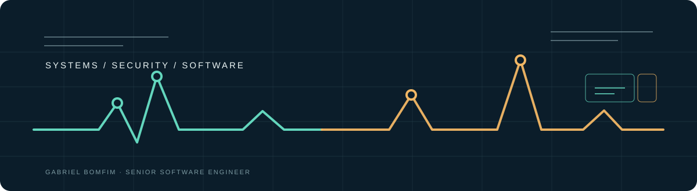

  

<h1 align="center">Gabriel Bomfim</h1>

  <strong>Senior Software Engineer | PHP · Laravel · React | Cybersecurity</strong>

  Backend systems, full-stack products, and security-focused engineering.

  <a href="https://www.linkedin.com/in/gbr-bomfim/">LinkedIn</a>
  ·
  <a href="https://www.gabrielbomfim.dev.br/">Portfolio</a>
  ·
  <a href="mailto:gbr.bomfim@gmail.com">Email</a>
  ·
  <a href="https://github.com/gabBomfim">GitHub</a>

---

## About me

I am a Senior Software Engineer with 7+ years of experience building enterprise software, integrations, and cybersecurity platforms.

My work sits mostly on the backend and at the boundaries between systems: APIs, background jobs, multi-tenant workflows, data-heavy applications, and integrations that need to keep working when the happy path ends. I also build the frontend when the product needs a clearer operational view.

I value practical architecture, explicit failure handling, and software that is understandable to the next engineer who has to change it.

## Career highlights

| Period | Experience |
| --- | --- |
| **2022 → now** | **Redbelt Security** · Senior Software Engineer working on enterprise cybersecurity software, GRC workflows, security controls, risk management, operational visibility, and integrations with platforms such as ServiceNow, Jira, and TOPdesk. |
| **2021 → 2022** | **THR Software** · Built business management and CRM systems, including a real estate management product and integrations that supported customer acquisition workflows. |
| **2019 → 2021** | **Holding RPX** · Worked on fintech and white-label banking systems, including a ticket workflow that replaced email-based customer requests with a more structured process. |

## Featured engineering work

### Security and operational systems

| Project | What it shows |
| --- | --- |
| [ControlScope](https://github.com/gabBomfim/ControlScope) | A security posture workspace with an explicit control scoring model, coverage by function, and improvement recommendations. **Laravel · React · TypeScript** |
| [IncidentFlow](https://github.com/gabBomfim/IncidentFlow) | An incident response workspace with state transitions, SLA signals, timeline events, and operational workflows. **Laravel · React · Redis** |
| [AccessLens](https://github.com/gabBomfim/AccessLens) | An access review workspace with RBAC, policy-aware risk signals, permission matrices, and auditable decisions. **React · TypeScript · Express · PostgreSQL** |

### Reliable integration tooling

| Project | What it shows |
| --- | --- |
| [HookRelay](https://github.com/gabBomfim/HookRelay) | A webhook delivery tool with HMAC signing, idempotency, bounded retries, transport inspection, and SSRF protection. **Symfony · PHP · PostgreSQL · Redis** |
| [TracePulse](https://github.com/gabBomfim/TracePulse) | An API health monitor with real checks, latency history, failure persistence, Docker support, and safe URL validation. **Laravel · React · TypeScript · Docker** |

### Independent product

[OrçaFast](https://github.com/gabBomfim/orcafast-backend) was a B2B SaaS product I designed and built across backend and frontend. It included multi-tenancy, quote sharing, view tracking, financial goals, team management, Stripe webhooks, transactional email, Docker-based deployment, and AI-assisted pricing suggestions.

The product is no longer in production. Its [backend](https://github.com/gabBomfim/orcafast-backend) and [frontend](https://github.com/gabBomfim/orcafast-frontend) repositories remain useful examples of the system's implementation.

## Engineering focus

<table>
  <tr>
    <td width="50%" valign="top">
      <h3>Build</h3>
      <ul>
        <li>Backend systems and domain rules</li>
        <li>REST APIs and enterprise integrations</li>
        <li>Queues, background processing, and webhooks</li>
        <li>Multi-tenant SaaS and complex workflows</li>
      </ul>
    </td>
    <td width="50%" valign="top">
      <h3>Protect and operate</h3>
      <ul>
        <li>Cybersecurity platforms and GRC</li>
        <li>NIST CSF, ISO 27001, and control maturity</li>
        <li>Incident response and vulnerability workflows</li>
        <li>Testing, CI/CD, observability, and safe failure paths</li>
      </ul>
    </td>
  </tr>
</table>

## Core stack

  <strong>Backend</strong> 
  PHP · Laravel · Symfony · Node.js · REST APIs · Background jobs

  <strong>Frontend</strong> 
  React · TypeScript · JavaScript · Vite

  <strong>Data and delivery</strong> 
  PostgreSQL · MySQL · Redis · Docker · GitHub Actions

## Connect

- [LinkedIn](https://www.linkedin.com/in/gbr-bomfim/)
- [Portfolio](https://www.gabrielbomfim.dev.br/)
- [Email](mailto:gbr.bomfim@gmail.com)
- [GitHub](https://github.com/gabBomfim)

Building software that stays clear when the system gets complicated.
